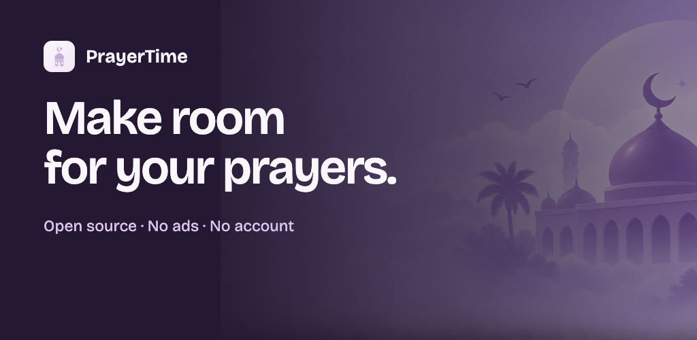
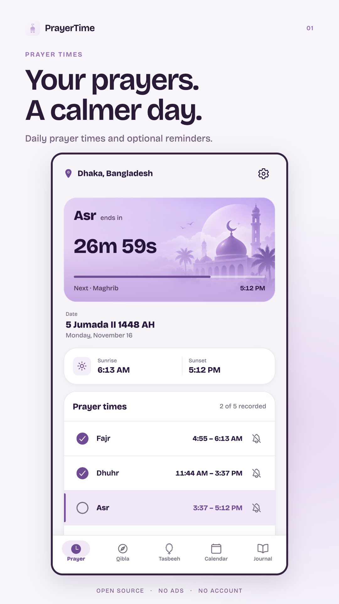
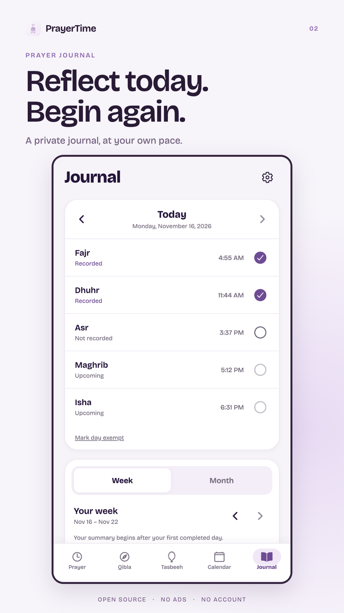
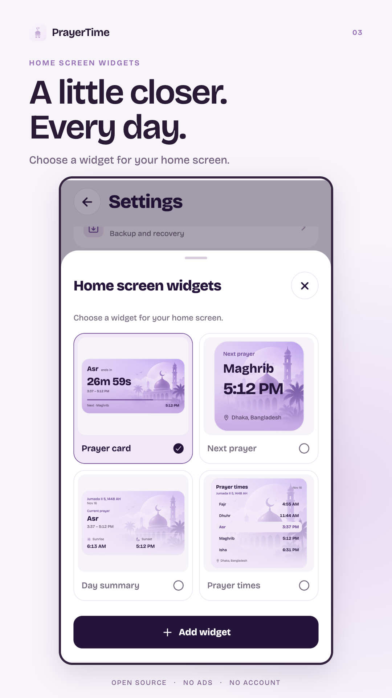

<p align="center">
  
</p>

<h1 align="center">PrayerTime</h1>

<p align="center">
  A little space for prayer in your everyday.<br>
  Prayer times, gentle reminders, and a private journal.
</p>

<p align="center">
  <a href="https://play.google.com/store/apps/details?id=com.hasanbuilds.prayertime">
    
  </a>
</p>

<p align="center">
  <a href="#a-look-inside">A look inside</a> &nbsp;·&nbsp;
  <a href="#run-it-locally">Run locally</a> &nbsp;·&nbsp;
  <a href="CONTRIBUTING.md">Contribute</a>
</p>

## A look inside

<p align="center">
  
  
  
</p>

| For your day | For your practice | Make it yours |
| --- | --- | --- |
| Prayer times and optional reminders | Private journal with weekly and monthly views | English, বাংলা, and العربية |
| Qibla compass and prayer calendar | Tasbeeh counter | Light and dark themes, text sizes, and artwork |
| Android and iPhone home screen widgets | Export and restore your saved records | Device location or manual coordinates |

Prayer times are calculated on your device. Your journal and Tasbeeh records stay there unless you share a backup. City search and some optional links need internet access.

## Run it locally

Built with **Expo · React Native · TypeScript**. Use [Node.js 24](https://nodejs.org/) (24.3 or newer) and npm. If you use nvm, run `nvm use` first.

```sh
git clone https://github.com/HasanC14/PrayerTime-Mobile-App.git
cd PrayerTime-Mobile-App
npm ci
cp .env.example .env
npm run web
```

Open the address shown in the terminal. No API key is needed to try the app: use your device's location or enter coordinates. For city search, add your own LocationIQ client key to `.env`. See [configuration](docs/configuration.md).

<details>
<summary><strong>Run on a phone</strong></summary>

```sh
npm start
```

Expo Go can show supported screens. Widgets and custom reminder controls need a native build:

```sh
npm run android
npm run ios
```

Android needs Android Studio and an emulator or connected phone. iOS needs macOS and Xcode. Rebuild after changing native modules or plugins.

The root `android/` and `ios/` folders are generated. Keep native source changes in `modules/`, `plugins/`, and `app.json`.

A web preview does not test phone notifications, sensors, or native widgets.

</details>

<details>
<summary><strong>Check your changes</strong></summary>

```sh
npm run typecheck
npm run lint
npm test
```

`npm run check` also runs Expo Doctor and may need internet access. Tests use sample data and do not need API keys.

</details>

<details>
<summary><strong>Find your way around the code</strong></summary>

| Folder | What is inside |
| --- | --- |
| `src/screens/` | App screens |
| `src/components/` | Shared UI |
| `src/hooks/`, `src/services/` | App logic, storage, prayer times, and reminders |
| `src/i18n/`, `src/content/` | Translations and prayer reflections |
| `modules/`, `plugins/`, `src/widgets/` | Native features and widgets |
| `assets/` | App icons and artwork |
| `tests/`, `.maestro/` | Automated checks |
| `docs/` | Setup, technical notes, and README visuals |

Local keys, builds, full marketing exports, and review images are ignored by Git. Selected README visuals are kept in `docs/assets/`.

</details>

## Help it grow

Ideas, bug reports, translations, and code are welcome. Start with [contributing](CONTRIBUTING.md) and the [code of conduct](CODE_OF_CONDUCT.md). For private security reports, follow the [security policy](SECURITY.md).

Building your own version? Follow the [fork guide](docs/configuration.md#eas-builds-and-forks) to set up your app identifiers, keys, and signing account. Maintainers can find the [public release steps](docs/public-release.md) and [device checks](docs/release-readiness.md) in the docs.

---

Project-owned code is [MIT licensed](LICENSE). Third-party material keeps its own terms; see [credits and notices](THIRD_PARTY_NOTICES.md).
